# KiepKeyboard

Fullscreen typing Android app for hardware USB keyboard. Designed as lightweight portable communication setup for disabled people.

For betatesting latest changes apply here: https://play.google.com/apps/internaltest/4699439541078434612

## Who it's for and how it's used

KiepKeyboard turns a phone plus a hardware USB keyboard into a single-purpose communication device. The phone runs locked to one fullscreen text field — no on-screen keyboard, no notifications, nothing else to get lost in. The laser-cut acrylic grid frame (see [Hardware](#hardware)) sits over the keys so that imprecise finger or pointer movements are guided onto one key at a time.

Beyond plain typing, physical keys are repurposed as commands so the user can communicate without leaving the text field: one key plays a **yes** or **no** sound and flashes the screen green or red (for quick caregiver-facing answers), and another **speaks the text aloud** once a sentence is written.

## Features

- **Distraction-free fullscreen editor** — immersive landscape, no system bars; typed text is restored after the app is backgrounded.
- **Yes / No** — dedicated keys play a yes/no sound and briefly flash the screen green/red (the flash can be disabled).
- **Text-to-speech** — speaks the last sentence in the buffer (the text after the last `.`, `!`, or `?`), in the device language.
- **Abbreviation expansion** — AutoHotKey-style snippets (e.g. `::kkb::KiepKeyboard`) expand as you type; Backspace undoes the last expansion.
- **Adjustable font size** — shrink/grow hotkeys (10–400 sp), remembered between sessions.
- **Battery bar** — on-screen battery level with a configurable low-battery warning that darkens the background.
- **Read-only .txt viewer** — a hotkey downloads a text file from a URL (e.g. a Dropbox share link) and shows it read-only.
- **Configurable command keys** — every command is remappable from the in-app settings, to any punctuation key or F1–F12 (plus Scroll Lock / Break).
- **In-app settings** — a low-profile button (bottom-right, can be hidden) opens all options.

### Default key mapping

| Key | Action |
| --- | --- |
| `[` | Speak the "no" sound + flash the screen red |
| `]` | Speak the "yes" sound + flash the screen green |
| `\` | Speak the last sentence aloud (text-to-speech) |
| `F9` / `F10` | Decrease / increase the font size |
| `F2` | Download and show the configured `.txt` file (only if a URL is set) |
| `Backspace` | Undo the last abbreviation expansion |

All keys are reconfigurable in Settings, and the yes/no, text-to-speech, battery bar, and .txt-download features can each be turned on or off. An abbreviation expands when you finish a word with a space, a newline, or one of `. , ? ! : ;`.

## Lock the phone to the app

A hardware keyboard's Esc/Back key exits the app instantly, which can strand the user on the Android launcher. Enable **app pinning** once per device so a stray keypress cannot leave KiepKeyboard:

1. Settings → Security → More security settings → **App pinning** (naming varies per Android version) → enable, and turn on "Ask for PIN before unpinning".
2. Open KiepKeyboard, open the recent-apps view, tap the app icon above the preview and choose **Pin**.

Unpinning (for the caregiver): hold Back + Recents (or swipe up and hold), then enter the device PIN.

## Hardware
[RL-K7 keyboard](https://www.aliexpress.com/item/4000336069065.html) with laser-cut acrylic glass grid frame overlay for typing support. The grid frame has an integrated phone stand. The keyboard has a modified cable; a short micro-USB OTG cable.

Download the DXF for laser cutting: [Raster_flat_0.21_kerf.dxf](Raster_flat_0.21_kerf.dxf)

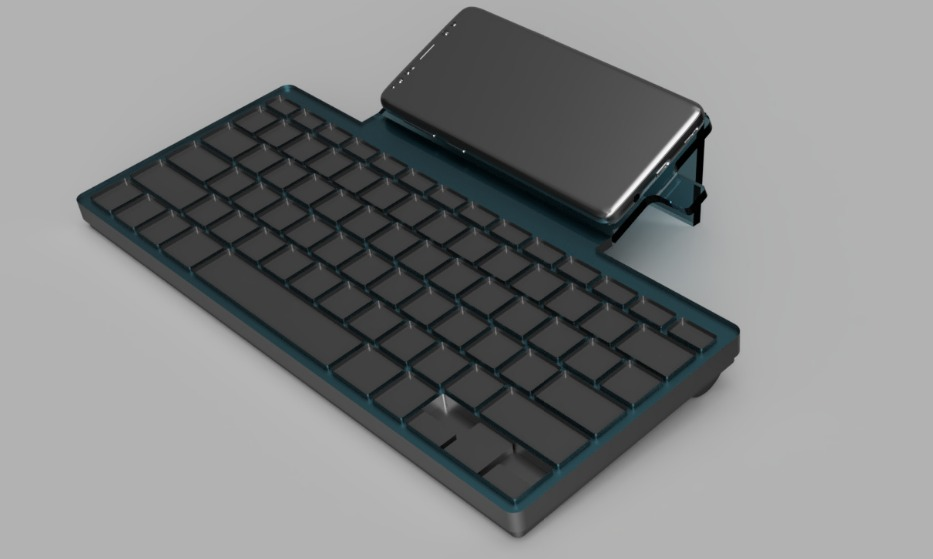

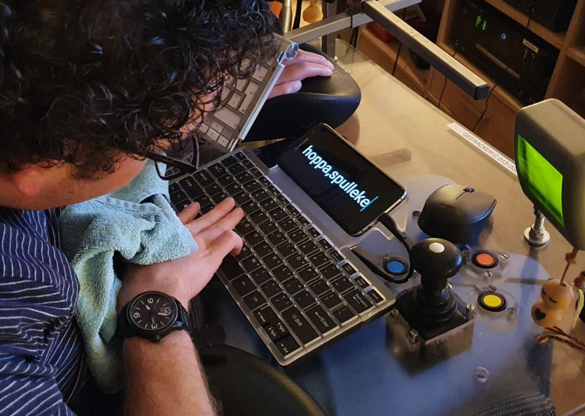

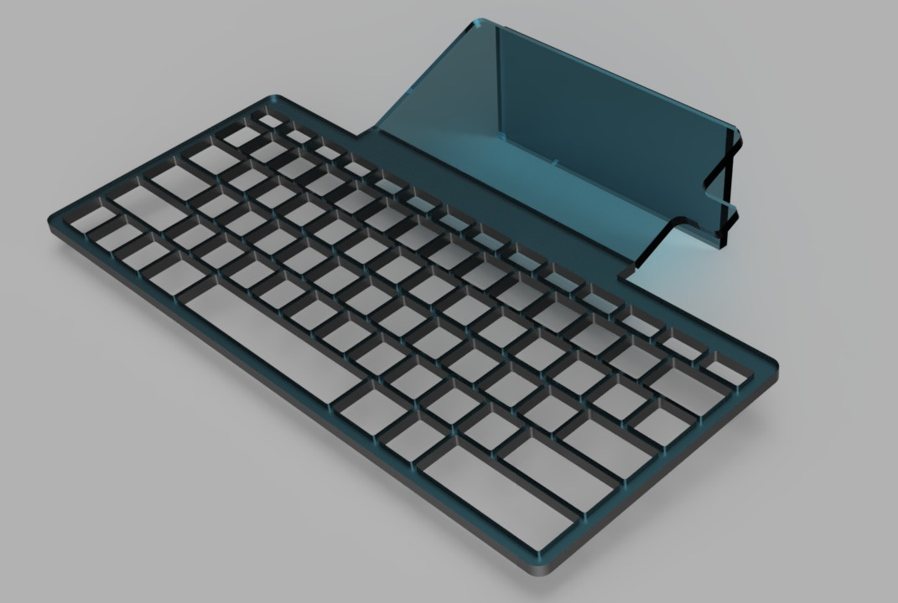

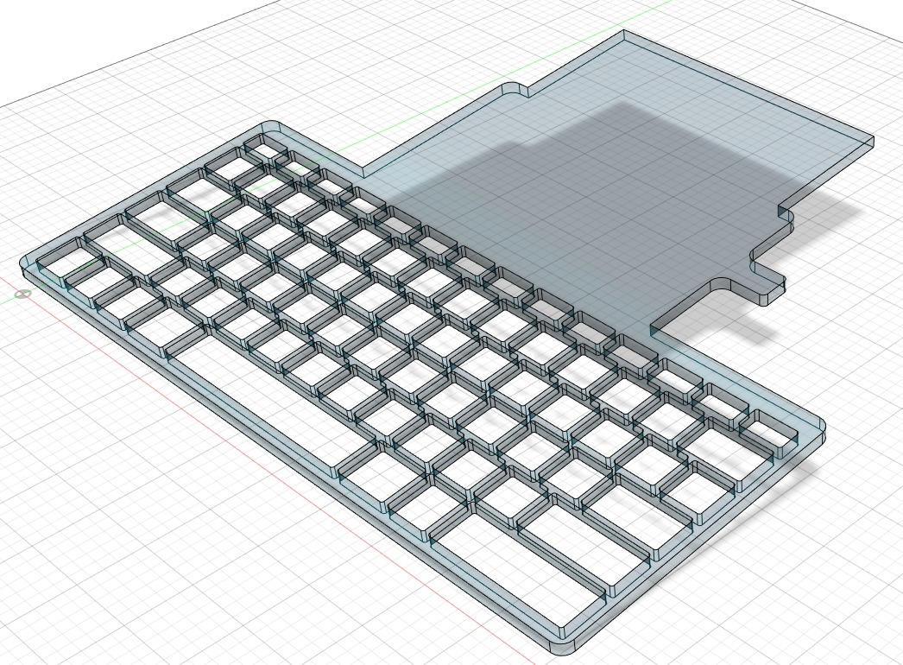

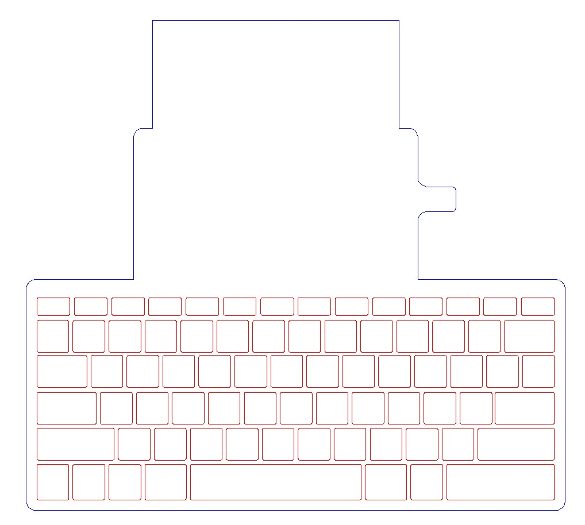

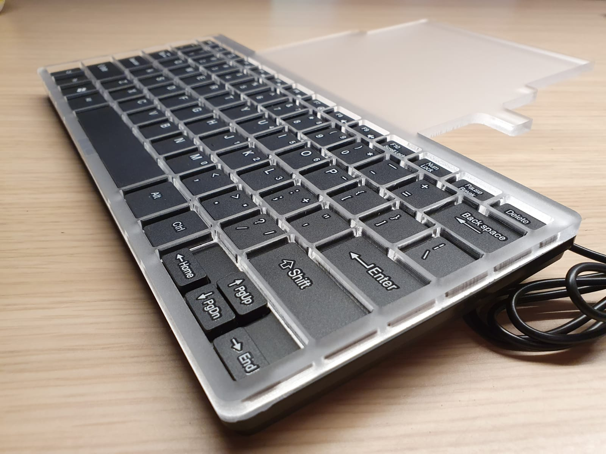

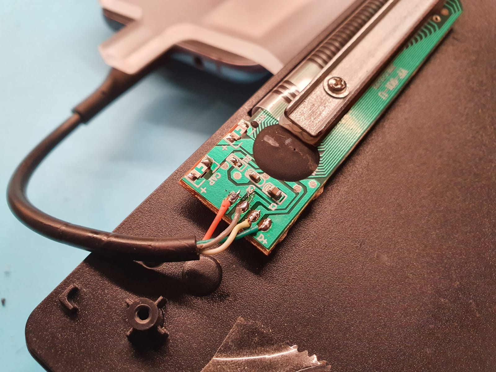

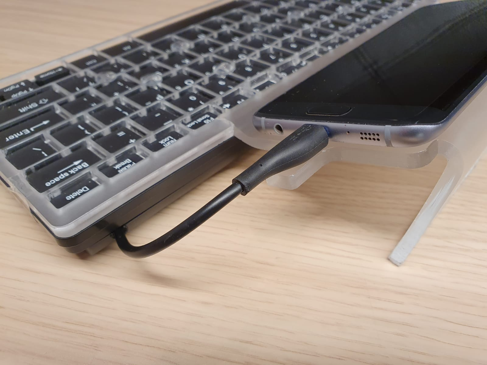

## Charging
The phone is charged wirelessly through the acrylic glass, using a special designed charging dock. The dock uses the internals of a [Samsung wireless charger](https://www.aliexpress.com/item/33001957782.html).

The STL for 3D printing: [Charge_dock.stl](Charge_dock.stl)

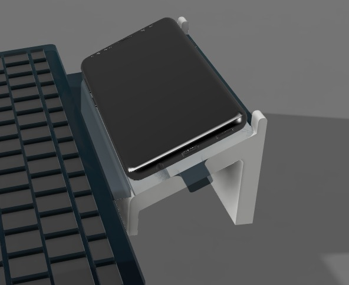

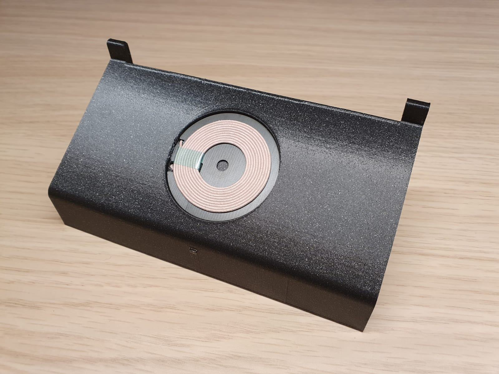

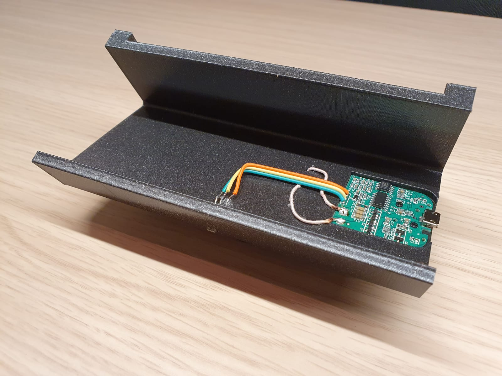

---
See [KiepProjects](https://github.com/Joozt/KiepProjects) for an overview of all Kiep projects.
